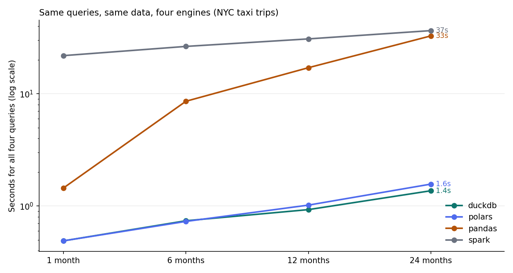

# Single machine or cluster? A four-engine benchmark on 79 million rows

[](https://github.com/VasilenData/taxi-engines-benchmark/actions/workflows/ci.yml)
[](LICENSE)

The same four analytical queries, run on the same public data with **DuckDB, Polars, pandas and Apache Spark**, at four sizes from 3 million to 79 million rows. Every engine's answer is checked against DuckDB's, so the timings compare engines that produce the same result.

Data: [NYC TLC yellow taxi trips](https://www.nyc.gov/site/tlc/about/tlc-trip-record-data.page), January 2023 to December 2024 (24 Parquet files, **79,479,802 trips** after filtering).



## What I found

| Dataset | DuckDB | Polars | pandas | Spark |
|---|---:|---:|---:|---:|
| 1 month | 0.5 s | 0.5 s | 1.4 s | 21.9 s |
| 6 months | 0.7 s | 0.7 s | 8.6 s | 26.5 s |
| 12 months | 0.9 s | 1.0 s | 17.1 s | 30.9 s |
| 24 months (79.5M rows) | **1.4 s** | **1.6 s** | **32.8 s** | **36.6 s** |

Total seconds for all four queries. Peak memory at 24 months: DuckDB 0.7 GB, Polars 4.3 GB, Spark 8.2 GB, pandas 19.4 GB. Full tables are in [results/summary.md](results/summary.md) and raw numbers in [results/results.csv](results/results.csv).

1. **For data that fits on one machine, DuckDB and Polars were about 20 times faster than pandas at 79 million rows** (1.4 s against 32.8 s) and used a fraction of the memory. pandas time grew with the data; DuckDB and Polars barely moved.
2. **Spark was not faster here.** Every measurement is a fresh process, so each Spark run includes about 5 seconds of session start-up. Even so, Spark's time stayed far above DuckDB's at every size. Spark earns its place when data no longer fits on one machine or jobs run on shared infrastructure, which this benchmark does not test.
3. **Real data fought back.** Each problem below is covered by a test:
   * **Schema drift:** the same column is `int32`, `int64` or `double` in different monthly files, and timestamps use different precisions. Polars refused to combine files until I cast them.
   * **Impossible dates:** 144 trips have pickup dates such as 2001 or 2026. They are filtered out in every engine.
   * **A borough called `N/A`:** pandas reads the text `N/A` as missing, so its join silently dropped trips. The cross-check against DuckDB caught it; the fix is `keep_default_na=False`.

## The four queries

| Query | What it does |
|---|---|
| `q1_groupby` | Trips, average fare and revenue per pickup zone |
| `q2_filter_derive` | Filter, then average tip percentage by hour and passenger count |
| `q3_join` | Join to the zone lookup table, then revenue by borough |
| `q4_window` | Top 3 pickup zones by revenue in each month (window `rank()`) |

## How it is measured, and the limits

* Every (engine, size, query) runs in a **fresh process**; the table shows the median of repeated runs. Each repetition is compared with the reference before its timing is accepted, and a mismatch fails the command. Peak memory is sampled across the whole process tree so Spark's JVM is counted. A timeout terminates the benchmark process and its observed children.
* Timing includes reading the files and ends when the result is a pandas DataFrame. Spark's start-up is included.
* **Warm cache:** the files were already in the operating system cache, so cold reads from a slow disk would narrow the gaps.
* Only 6 of 19 columns are read. pandas could be made faster with tuning or chunking; I measured the straightforward version most people would write.
* One machine: a 17-core cloud VM. pandas is single-threaded by design. Absolute numbers will differ on your hardware; the ratios and the correctness checks are the point.
* Not tested: data larger than memory, multi-node Spark, cold caches, concurrent users.

Dataset tiers require their exact published months. A missing file fails before measurement instead of silently benchmarking a smaller dataset under the requested tier's name; unrelated monthly files are excluded. Duplicate matrix selections and malformed/non-finite worker measurements are refused. Each repetition writes a fresh temporary Parquet path; missing/corrupt outputs and row counts that disagree with worker metadata become recorded failures, so a stale earlier result cannot validate a later timing. All successful repetitions compare against the first validated DuckDB result held in memory, and temporary outputs are cleaned after the run. CSV progress checkpoints are written to a temporary file beside the destination and atomically replaced, so a serialization/write failure preserves the previous complete checkpoint. Reports reject duplicate cases and non-finite successful timings instead of inflating totals. Reports identify failed/mismatched cases explicitly and describe agreement only for the recorded cases. The historical results above have not been rerun as part of these runner safeguards.

## Run it

```bash
pip install -r requirements.txt
scripts/download.sh data                                              # about 1.3 GB
DATA_DIR=data PYTHONPATH=src python -m tbench.orchestrate --reps 3    # long run
DATA_DIR=data PYTHONPATH=src python -m tbench.report                  # tables and chart
pytest -q                                                             # all engines must agree on awkward data
```

Spark needs Java 17. CI runs `pytest` on every push with a small file set that contains mixed column types, impossible dates and the `N/A` borough, and fails if any engine disagrees with DuckDB.
